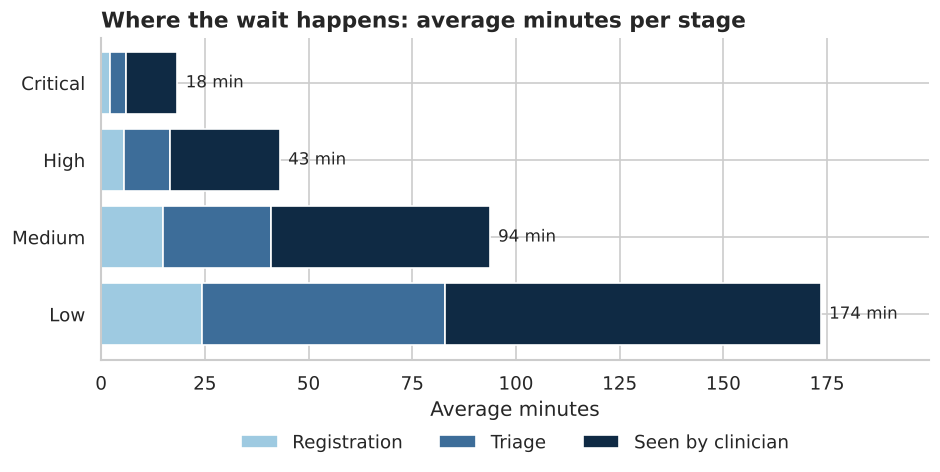
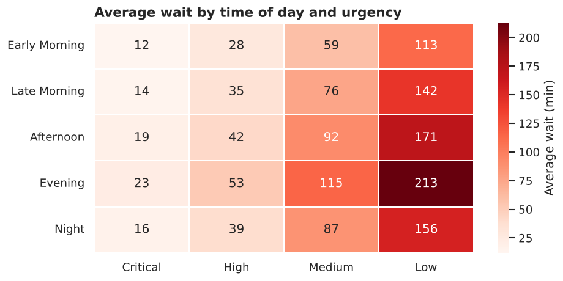
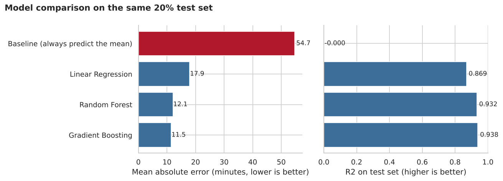

# ER Wait Time: Analysis and Prediction

Analysis of 5,000 emergency room visits across five hospitals in 2024, and a machine learning model that estimates a patient's total wait using only information available when they arrive.

**Live demo:** LIVE_DEMO_URL



## Problem

Emergency rooms deal with unpredictable arrivals and limited staff. Long waits lower patient satisfaction and lead some patients to leave without being seen. This project answers:

1. What drives the wait: urgency, time of day, day of week, season or staffing?
2. Which part of the visit takes the longest?
3. How do long waits relate to patients leaving without being seen?
4. Can the wait be predicted at arrival, and how accurately?

## Dataset

Source: [ER Wait Time](https://www.kaggle.com/datasets/rivalytics/er-wait-time) on Kaggle, saved as `data/er_visits.csv`.

5,000 visits to five hospitals between 1 January and 30 December 2024, with 19 columns:

| Group | Columns |
|---|---|
| Visit | Visit ID, Patient ID, Hospital, Region, Visit Date, Day of Week, Season, Time of Day |
| Triage and resources | Urgency Level, Nurse-to-Patient Ratio, Specialist Availability, Facility Size (Beds) |
| Stage times | Time to Registration, Time to Triage, Time to Medical Professional (minutes) |
| Target | Total Wait Time (minutes) |
| After the visit | Patient Outcome, Patient Satisfaction |

## Data quality

- No missing values and no duplicate visits.
- Total wait time equals the sum of the three stage times in every row.
- The `Time of Day` label matches the clock hour in `Visit Date` for only 18% of visits. It still separates waits clearly, so it is used as given and the hour is kept as its own column.
- Wait times are right-skewed (median 60, mean 82 minutes, skewness 1.19). The long tail is real and mostly low-urgency patients, so it is kept.

## Key findings

| Urgency | Visits | Mean wait | Median wait | 90th percentile |
|---|---|---|---|---|
| Critical | 1,242 | 18 min | 17 min | 30 min |
| High | 1,245 | 43 min | 41 min | 65 min |
| Medium | 1,291 | 94 min | 89 min | 138 min |
| Low | 1,222 | 174 min | 165 min | 249 min |

- **Urgency decides most of the wait.** Low-urgency patients wait almost ten times as long as critical patients.
- **Time with the clinician is the longest stage**, about half of the total wait at every urgency level.
- **Evenings, Mondays and winter are the slowest.** Evening waits average 100 minutes against 52 in the early morning, Monday 102 against 67 on Sunday, and winter 99 against 66 in fall.
- **Staffing matters less than it first appears.** Average wait rises from 16 minutes at a nurse-to-patient ratio of 1 to 172 minutes at 5, but staffing follows urgency in this data (critical patients were only seen at ratios 1 and 2, low-urgency patients only at 4 and 5). Within the same urgency level, one more patient per nurse adds 5 to 16 minutes.
- **Specialist availability and facility size show no relationship** with the wait.
- **Long waits drive walk-outs.** 16% of low-urgency patients left without being seen, after waiting 179 minutes on average.



## Model

### Inputs

The model has to work for a patient who has just arrived, so it only uses urgency level, time of day, day of week, season, region, hospital, nurse-to-patient ratio, specialist availability, facility size and hour of arrival.

The three stage times are excluded because they add up exactly to the target. Patient outcome and satisfaction are excluded because they are recorded after the visit.

### Leakage check

| Features | MAE | R2 |
|---|---|---|
| Arrival information only | 12.2 min | 0.931 |
| Including stage times, outcome and satisfaction | 1.4 min | 0.998 |

The second model only has to add three numbers together. Its score looks excellent but it could never be used for a new patient. An earlier version of this project made this mistake and reported R2 = 0.99999.

### Results

Same 80/20 split for every model, plus 5-fold cross-validation on all 5,000 visits.

| Model | MAE | RMSE | R2 (test) | R2 (5-fold CV) |
|---|---|---|---|---|
| Baseline (always predict the mean) | 54.7 min | 68.2 | 0.000 | 0.000 |
| Linear Regression | 17.9 min | 24.7 | 0.869 | 0.875 |
| Random Forest | 12.1 min | 17.9 | 0.932 | 0.933 |
| **Gradient Boosting** | **11.5 min** | **17.0** | **0.938** | **0.938** |

Gradient Boosting is used in the app. 76% of its test predictions are within 15 minutes of the actual wait. Errors grow with the wait: about 4 minutes for critical patients and 21 minutes for low-urgency patients. Permutation importance shows the model relies mainly on urgency level, then time of day, season and day of week.



## Recommendations

- Add staff to evening and Monday shifts and during winter, when waits are longest.
- Set up a fast track for low-urgency patients to reduce walk-outs.
- Show arriving patients an estimated wait based on this model.

## Web app

The Streamlit app has five tabs:

- **Predict a wait:** enter a patient's urgency, arrival time and hospital conditions to get an estimated wait
- **Overview:** headline numbers, wait distribution, arrivals by hour and a per-hospital summary
- **What drives the wait:** urgency, stages, time of day, outcomes and staffing
- **Model:** model comparison, actual vs predicted, feature importance and the leakage check
- **Data quality:** checks and notes on the data, with a download of the dataset

## Tech stack

Python, Pandas, NumPy, Matplotlib, Seaborn, SciPy, scikit-learn, Streamlit, Jupyter Notebook

## Project structure

```
er-wait-time-prediction/
├── app.py                              Streamlit app
├── data/
│   └── er_visits.csv                   Kaggle dataset
├── notebooks/
│   └── er_wait_time_analysis.ipynb     Full analysis, modeling and findings
├── reports/
│   ├── figures/                        Charts exported by the notebook
│   ├── model_comparison.csv
│   └── feature_importance.csv
├── src/
│   ├── analysis.py                     Data loading, summaries and charts
│   └── model.py                        Features, model training, evaluation and leakage check
├── requirements.txt
└── README.md
```

## Run locally

```bash
git clone https://github.com/Qasim00760/er-wait-time-prediction.git
cd er-wait-time-prediction
pip install -r requirements.txt
streamlit run app.py
```

To run the notebook:

```bash
pip install notebook
jupyter notebook notebooks/er_wait_time_analysis.ipynb
```

## Author

Muhammad Qasim
[Portfolio](https://qasim.devsil.com) | [LinkedIn](https://www.linkedin.com/in/muhammad-qasim-1944b8349) | [GitHub](https://github.com/Qasim00760)
